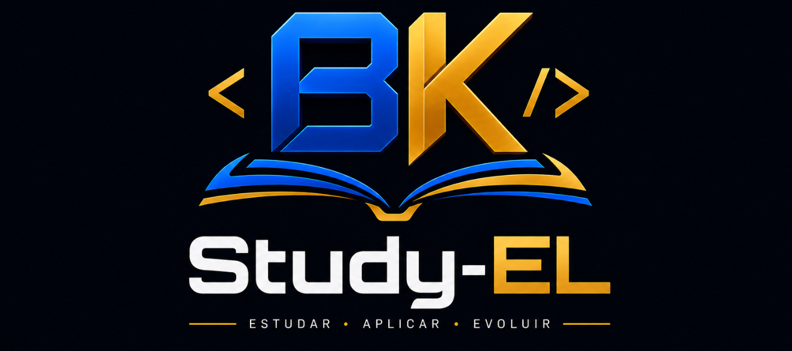

   

# Sobre

Um ambiente para transformar conhecimento em aplicação prática.

O Study-EL é um projeto de desenvolvimento contínuo criado para resolver uma dificuldade que encontro durante meus estudos: aprender novas tecnologias e conceitos, mas nem sempre ter um contexto adequado para aplicá-los.

A proposta é construir um sistema que ofereça problemas e necessidades reais o suficiente para justificar a implementação, a investigação e a evolução das soluções. Em vez de limitar o aprendizado a exercícios isolados ou projetos feitos apenas para acompanhar um curso, quero ter um projeto no qual o conhecimento estudado encontre uma aplicação.

O Study-EL está sendo construído, antes de tudo, como um laboratório de aplicação. Não é uma plataforma de cursos: seu foco é oferecer um lugar para colocar em prática aquilo que se estuda.
Por que o projeto existe?
Fazer exercícios e pequenos projetos sempre foi uma forma de praticar o que aprendo. Ainda assim, muitos desses projetos pareciam desconectados de uma necessidade concreta. Eu queria mais do que implementar um CRUD ou reproduzir uma aplicação de tutorial para dizer que utilizei determinada tecnologia.

O que me motiva é ter um motivo para usar o conhecimento: encontrar um problema, investigar como resolvê-lo e perceber que a solução faz parte de algo maior. Também quero lidar gradualmente com desafios que aparecem em sistemas mais completos, como organização da arquitetura, autenticação, segurança, concorrência, desempenho e escalabilidade.

Essa motivação está detalhada em [VISION.md](docs/VISION.md).
Como o Study-EL pretende funcionar?
A proposta se apoia principalmente em duas possibilidades:
- Laboratórios de estudo: espaços dentro do próprio projeto nos quais posso aplicar tecnologias e conceitos diferentes. Cada laboratório deve ter uma razão para existir dentro do Study-EL; a intenção não é inserir aplicações sem relação com o restante do sistema apenas para praticar uma tecnologia.
- Evolução e reimplementação: partes da aplicação poderão ser revistas ou reconstruídas quando eu estudar um novo conceito, padrão de projeto ou tecnologia. Assim, será possível comparar abordagens, entender suas diferenças e melhorar soluções existentes com uma justificativa concreta.
Com o crescimento do projeto, poderão surgir sistemas menores dentro dele. A arquitetura deve acompanhar as necessidades reais da aplicação, em vez de ser criada apenas para reproduzir a estrutura de um sistema grande.
Primeiro passo: sistema de acesso
O primeiro recorte de desenvolvimento será o sistema de acesso. Ele permitirá trabalhar fundamentos de interface, prototipação, lógica, backend, persistência de dados, autenticação e segurança.

---

A direção técnica atual é:
- Protótipo: Figma.
- Interface inicial: HTML e CSS, para fortalecer os fundamentos antes de adotar um framework.
- Backend: Java com Spring está no planejamento atual; a escolha será consolidada durante a definição da arquitetura.
- Banco de dados: PostgreSQL está previsto para essa etapa.
Essas escolhas representam o planejamento atual, não decisões imutáveis. A evolução técnica será documentada conforme as decisões forem tomadas.
O que quero alcançar
- Ter um ambiente contínuo no qual os conhecimentos que estudo possam ser aplicados.
- Construir um projeto que evolua e apresente desafios técnicos progressivamente mais interessantes.
- Desenvolver e demonstrar conhecimentos de tecnologias e também de fundamentos de engenharia de software.
- Criar algo que possa inspirar outros estudantes a desenvolverem seus próprios projetos.
- Explorar, futuramente, formas de outras pessoas aproveitarem o Study-EL e contribuírem com melhorias e aplicações de conhecimentos.
A ideia de disponibilizar trilhas de conhecimento, reunindo materiais de estudo que considero úteis, também está sendo considerada. Ainda é uma possibilidade em avaliação, não uma funcionalidade definida.
Estado atual
O projeto está na etapa de planejamento e prototipação. O foco imediato é preparar o primeiro sistema de acesso:
- [x] Definir o propósito do projeto.
- [x] Identificar o problema que motivou sua criação.
- [x] Escolher o sistema de acesso como primeiro ponto de desenvolvimento.
- [ ] Criar o protótipo no Figma.
- [ ] Definir a identidade visual.
- [ ] Projetar a arquitetura e os dados do sistema de acesso.
- [ ] Implementar a primeira versão da interface e do backend.
O planejamento completo está em [ROADMAP.md](docs/ROADMAP.md).
Documentação
- [Visão do projeto](docs/VISION.md) — origem, problema, motivação, princípios e direção do Study-EL.
- [Roadmap](docs/ROADMAP.md) — etapas atuais e possíveis caminhos de evolução.
A documentação será atualizada conforme o projeto e as decisões técnicas evoluírem.